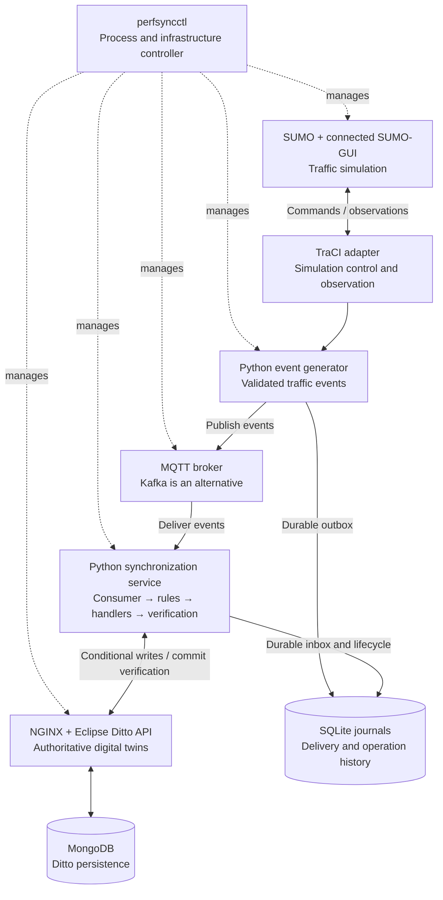

# PerfSyncGNN Phase 2 — System Overview

## Purpose and scope

Phase 2 connects simulated traffic to verified digital-twin (DT) state. It supports
SUMO traffic observation, deterministic synchronization operations, persistent state,
commit verification, lifecycle logging and restart recovery.

GNN prediction, model training and OpenWhisk serverless execution belong to later phases.
Local Python execution durations are not serverless latency measurements.

## Live architecture



Solid arrows represent data exchange. Dashed arrows represent launcher management.
TraCI and event generation run in the producer process. The synchronization service
runs in a separate consumer process when a broker is selected. Producer and consumer
have separate SQLite journal files.

## Components and responsibilities

| Component | Responsibility |
|---|---|
| `perfsyncctl` | Starts and supervises required processes and retained Docker services, checks readiness, exposes status/logs and safely stops owned resources. |
| SUMO | Simulates vehicles, movement, lanes, arrivals, departures and traffic signals. |
| SUMO-GUI | Displays the same TraCI-controlled simulation and provides visual pause/resume controls. |
| TraCI adapter | Advances simulation steps and extracts entity observations, source timestamps and sequences. |
| Scenario configuration | Defines the network, seed, vehicle arrival rate, observation interval and logical RSU ownership boundary. |
| Event generator | Creates validated events containing entity IDs, source RSUs, sequence numbers, timestamps and process variables. |
| Mosquitto MQTT or Apache Kafka | Transports events between the producer and synchronization consumer. They are alternative transport paths. |
| Synchronization service | Handles duplicate/stale events, identifies operations using deterministic rules, enforces ordering, executes handlers and verifies commits. |
| Eclipse Ditto | Provides the interface for authoritative DT entities, process variables, associations, subscriptions, ownership and application versions. |
| NGINX | Provides the configured authenticated HTTP entry point to Ditto. |
| MongoDB | Persists Ditto state; synchronization code accesses state through Ditto rather than writing directly to MongoDB. |
| SQLite journals | Preserve producer outbox, consumer inbox, operation records, dependencies, errors and lifecycle history for recovery and analysis. |

RSUs are logical ownership regions derived from configured coordinates. They are not
separate deployed roadside devices or drawn coverage overlays in the current scenario.

## Synchronization operations

| Operation | Trigger and mission |
|---|---|
| Attach | Establish a physical-to-digital association when an admissible insertion/observation requires one. |
| Follow | Record an explicitly requested tracking subscription or an authorized renewal. |
| Update | Apply a newer admissible observation to an attached DT under the expected owner. |
| Transfer | Change synchronization ownership when a newer observation indicates a configured RSU boundary crossing. |
| Detach | Invalidate the association when an admissible departure/removal indicates it is no longer required. |

One event can require multiple operations. Initial association follows **Attach → Update**;
a CLI tracking request follows that initial update. An ownership crossing follows
**Transfer → Update**. Ordinary observations do not automatically create Follow requests.

## Example event-to-commit flow

1. A vehicle moves from the west logical RSU region into the east region.
2. TraCI observes its position and derives the new source/owner region.
3. The event generator validates and publishes the observation through MQTT or Kafka.
4. The consumer durably ingests the event; the manager checks ordering and current DT state.
5. The manager identifies Transfer followed by its dependent Update.
6. Handlers apply conditional state changes through Ditto and verify the required transitions.
7. The journal records COMMITTED only after successful verification.

A broker acknowledgement or successful handler return alone is not proof of a DT commit.

## State, consistency and lifecycle

Each DT maintains physical/digital identity, committed process variables, application
version, source timestamp/sequence, association, subscription and ownership metadata.

Successful operations follow:

```text
CREATED → VALIDATED → QUEUED → RUNNING → COMMITTING → COMMITTED
```

The model also supports FAILED, CANCELLED and SUPERSEDED terminal outcomes. Failed,
cancelled or superseded operations do not receive successful-commit latency labels.

The implementation uses deterministic ordering, duplicate/stale rejection, conditional
version checks and atomic operation receipts. Journals support retry and process-restart
recovery. This is a single-host writer protocol, not a globally atomic transaction across
broker, journal and Ditto.

SUMO/source timestamps use simulation milliseconds. Execution timestamps use separate
wall-clock fields; valid durations use a monotonic clock within the same executor session.

## Supported execution paths

| Path | Components |
|---|---|
| Local DT test | SUMO/GUI → TraCI → generator → manager → SQLite test DTs |
| Direct live DT | SUMO/GUI → TraCI → generator → manager → Ditto → MongoDB |
| Broker-based live DT | SUMO/GUI → TraCI → generator → MQTT or Kafka → consumer/manager → Ditto → MongoDB |

In live Ditto paths, SQLite stores journals while Ditto/MongoDB stores authoritative DT
state. In explicit SQLite test mode, a separate SQLite database stores the test DT state.

## Basic commands

Run from `/home/hpclab-lananh/PerfSyncGNN`:

```bash
# Connected GUI with local SQLite DTs
./scripts/perfsyncctl gui --follow

# Connected GUI with live MQTT and Ditto
./scripts/perfsyncctl start --live --broker mqtt --gui --follow

# Switch an existing run to the live workflow
./scripts/perfsyncctl restart --live --broker mqtt --gui --follow

# Inspect and stop
./scripts/perfsyncctl status
./scripts/perfsyncctl logs --service sumo
./scripts/perfsyncctl stop
```

The default launcher permits one active run at a time. Each new run receives a fresh
output directory and run identity. A separately launched standalone SUMO-GUI replay does
not feed the synchronization pipeline; the launcher's GUI option does.

## Related documentation

- [One-command launcher guide](PHASE2_ONE_COMMAND_GUIDE.md)
- [Launcher verification report](PHASE2_LAUNCHER_VERIFICATION.md)
- [Detailed Phase 2 user guide](PHASE2_USER_GUIDE.md)
